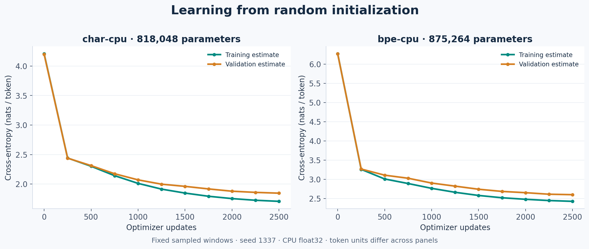
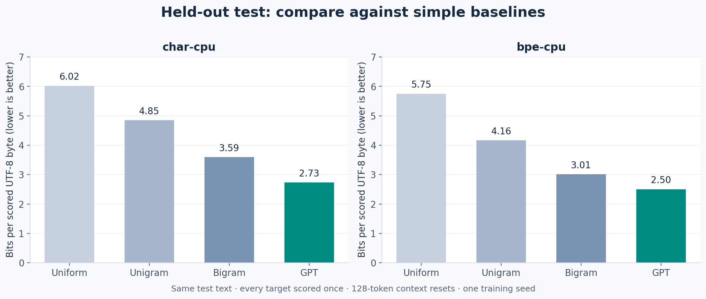
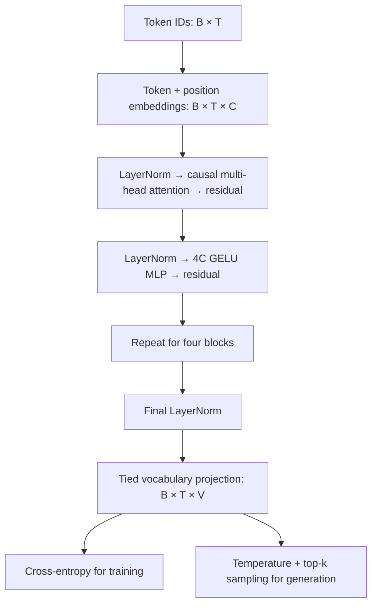

# GPT-2 From Scratch in PyTorch

A compact GPT-style language model trained from random initialization on Tiny Shakespeare.
The project implements byte-pair encoding, explicit causal attention, training, evaluation,
and text generation, with reproducible experiment evidence and a detailed learning guide.

**Start here:** [step-by-step walkthrough](docs/STEP_BY_STEP.md) ·
[measured results](docs/RESULTS.md) · [model card](docs/MODEL_CARD.md) ·
[interview guide](docs/INTERVIEW_GUIDE.md)

## What this project demonstrates

| Area | Implementation and evidence |
|---|---|
| Tokenization | Character baseline and actual byte BPE with deterministic merges and UTF-8 round-trip tests |
| Transformer internals | Explicit Q/K/V projections, scaled dot products, causal masking, multi-head composition, pre-LN blocks, GELU, and tied embeddings |
| Training engineering | AdamW, warmup/cosine schedule, gradient clipping, fixed validation windows, best/last checkpoints, and exact CPU resume test |
| Evaluation | Train-only tokenizer fitting, contiguous train/validation/test split, full held-out scoring, unigram/bigram baselines, and bits per byte |
| Reproducibility | Seed, config, environment, data fingerprints, source hashes, raw metric logs, and fixed-seed sample policy |
| Code quality | Behavioral tests, lint/format checks, packaged source layout, and GitHub Actions configuration |

PyTorch supplies tensors, autograd, primitive layers, and AdamW. The model is composed
explicitly; there are no pretrained weights, Hugging Face model classes, `nn.Transformer`
blocks, or nanoGPT dependencies. The supplied GPU preset uses an optional SDPA backend;
the recorded CPU experiments use the explicit attention implementation.

## Results

Two CPU experiments use four transformer blocks, four attention heads, width 128, and a
128-token context. Each runs for 2,500 updates with seed 1337. See the
[generated experiment table](reports/README.md) for measured values and the
[results analysis](docs/RESULTS.md) for the evaluation protocol and limitations.

| Completed CPU run | Parameters | Test bits/byte ↓ | Wall time |
|---|---:|---:|---:|
| Character | 818,048 | 2.730 | 9.18 min |
| Byte BPE | 875,264 | 2.502 | 9.67 min |

Both beat their corresponding bigram baseline. These are descriptive results from
one training seed; the tokenizers differ in parameter count and effective text context.





Raw evidence lives in [reports/char-cpu](reports/char-cpu) and
[reports/bpe-cpu](reports/bpe-cpu): configs, environment, metrics, evaluation, and all
three predefined samples for each model. No samples are rejected or rewritten.

**Scope:** this is a small educational model inspired by GPT-2. It does not reproduce
OpenAI's original model size, tokenizer, weights, training corpus, or capabilities.
Text can resemble dialogue while remaining incoherent. One training seed is reported;
the runs are not a controlled comparison of tokenizer quality.

## Run it

Use Python **3.11 or 3.12**. The recorded environment is Windows / Python 3.12.14 /
PyTorch 2.7.1 CPU. On Windows PowerShell, from this folder:

```powershell
py -3.12 -m venv .venv
.\.venv\Scripts\python.exe -m pip install torch==2.7.1 --index-url https://download.pytorch.org/whl/cpu
.\.venv\Scripts\python.exe -m pip install -r requirements-dev.txt
.\.venv\Scripts\python.exe -m pip install -e . --no-deps
.\.venv\Scripts\python.exe scripts/check_environment.py
```

If the environment already exists, skip installation. Activate it using
`.\.venv\Scripts\Activate.ps1`, or replace `python` below with
`.\.venv\Scripts\python.exe`. On Linux/macOS create the environment with
`python3.12 -m venv .venv` and activate using `source .venv/bin/activate`.

```bash
# 1. Check implementation correctness (uses synthetic data; no download).
python -m pytest -q

# 2. Download verified data and prepare the character baseline.
python scripts/download_data.py
python scripts/prepare_data.py --tokenizer char
python scripts/inspect_batch.py --data data/processed/char

# 3. Run a short pipeline check, then the full CPU experiment.
python train.py --config configs/smoke.json --out runs/my-smoke
python train.py --config configs/char_cpu.json --out runs/my-char

# 4. Evaluate the selected checkpoint and generate text.
python evaluate.py --checkpoint runs/my-char/best.pt --data data/processed/char --split both
python generate.py --checkpoint runs/my-char/best.pt --prompt "ROMEO:" --tokens 300 --seed 42

# 5. Repeat with actual byte-pair encoding.
python scripts/prepare_data.py --tokenizer bpe --vocab-size 512
python train.py --config configs/bpe_cpu.json --data data/processed/bpe --out runs/my-bpe
python evaluate.py --checkpoint runs/my-bpe/best.pt --data data/processed/bpe --split both

# 6. Export logs, fixed samples, tables, and plots for both completed runs.
python scripts/export_report.py --runs runs/my-char runs/my-bpe --out reports/my-experiments
```

Prepared-data directories and new run directories must be empty. Reuse prepared data
without rerunning preparation; use a new output path for a new experiment. Keep the
test partition for final evaluation after validation-based decisions.

### Benchmark, resume, or use a GPU

```bash
python scripts/benchmark.py --config configs/char_cpu.json
python train.py --config configs/char_cpu.json --out runs/pause-demo --stop-after 500
python train.py --config configs/char_cpu.json --out runs/pause-demo --resume runs/pause-demo/last.pt
```

The measured update throughput is hardware-dependent. The benchmark estimates time
before a long run. Resume requires identical config, data, tokenizer, and source;
it restores weights, optimizer moments, and random states from `last.pt`.

For CUDA, install a compatible build from the [official PyTorch selector](https://pytorch.org/get-started/locally/),
then use `--config configs/gpu.json`. That preset is provided for future experiments;
no GPU training result or speedup is claimed here. CPU and GPU results need not be
bit-for-bit identical.

## Architecture



The `manual` attention path computes `softmax(QKᵀ / √d + mask)V`. The `sdpa` path is
checked against it for both outputs and gradients. The model always returns full
`[batch, time, vocabulary]` logits, making its API and causal tests straightforward.

## Repository map

```text
src/gpt2_scratch/
  tokenizer.py     Character and byte BPE implementations
  data.py          Splits, manifests, encoding, and batches
  model.py         Attention, MLP, blocks, and GPT
  trainer.py       Updates, evaluation, scheduling, and checkpoints
  evaluation.py    Full-split scoring and statistical baselines
  generation.py    Load a checkpoint and generate text
  config.py        Validated architecture and training settings
  runtime.py       Seeds, device selection, metadata, and serialization
configs/          Smoke, CPU character/BPE, and GPU presets
tests/            Behavioral and integration tests
scripts/          Data preparation, inspection, benchmark, reports, and packaging
docs/             Tutorial, results, model card, and presentation/publishing guides
reports/          Small, measured artifacts suitable for GitHub
train.py          Training command
evaluate.py       Held-out evaluation command
generate.py       Generation command
```

The environment, raw/encoded data, and model checkpoints are ignored by Git.
On a fresh clone, train before running generation. The local workspace retains trained
weights under `runs/`; they can be distributed separately as release assets if desired.

## Verification

```bash
python -m pytest -q
python -m ruff check .
python -m ruff format --check .
```

**Local result: 37 tests passed**, with clean lint/format checks. The actual outputs
are saved in [reports/verification.json](reports/verification.json). Recreate that
report with `python scripts/verify_project.py`.

The tests cover tokenization, data isolation, causal attention, gradients, tiny-batch
overfitting, generation reproducibility, evaluation coverage, and checkpoint recovery.
The GitHub Actions workflow configures Linux and Windows checks. Hosted CI has to run
after publication; the existence of the workflow is not a passing CI result.

## Learning and attribution

The implementation was developed with AI assistance from a supplied project brief,
then tested and trained locally. The [walkthrough](docs/STEP_BY_STEP.md) explains the
math and engineering decisions; the [interview guide](docs/INTERVIEW_GUIDE.md) helps
present the work accurately and suggests independent follow-up experiments.

The architecture draws on the [GPT-2 report](https://cdn.openai.com/better-language-models/language_models_are_unsupervised_multitask_learners.pdf)
and [Attention Is All You Need](https://arxiv.org/abs/1706.03762). The data comes from
[char-rnn's Tiny Shakespeare](https://github.com/karpathy/char-rnn/tree/master/data/tinyshakespeare).
The BPE background is [Sennrich et al.](https://aclanthology.org/P16-1162/).

Code license: [MIT](LICENSE). Publishing instructions: [GitHub guide](docs/GITHUB_PUBLISH.md).

More context: [design decisions](docs/DESIGN_DECISIONS.md) and
[troubleshooting](docs/TROUBLESHOOTING.md).
