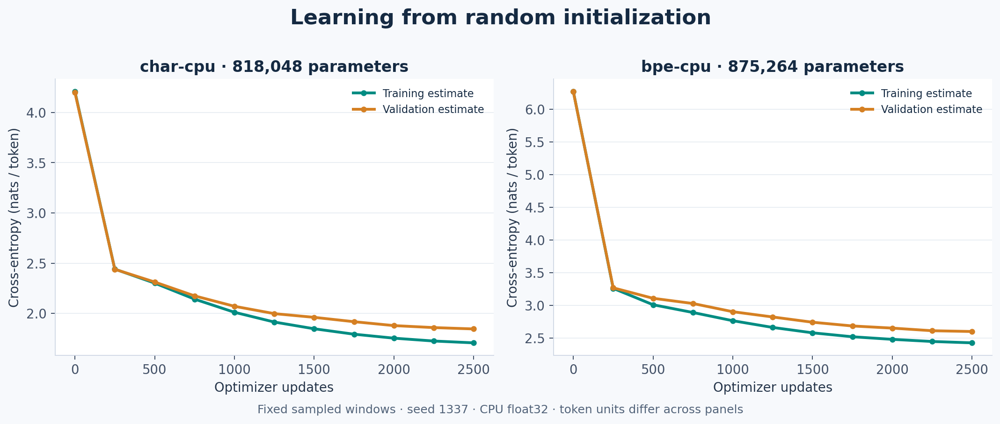
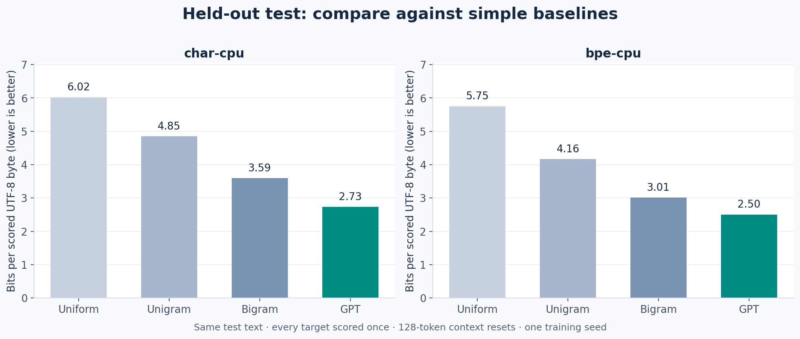

# Measured results

Both small GPT models beat their corresponding bigram baseline on held-out Tiny
Shakespeare text. These are completed local CPU runs, not projected GPU results.
The character model reduces test cross-entropy by **24.0%** relative to its bigram
baseline; the BPE model reduces it by **17.0%**. These are reductions in predictive
loss, not increases in classification accuracy.

## Experiment setup

| Setting | Character | Byte BPE |
|---|---:|---:|
| Vocabulary | 65 | 512 |
| Parameters | 818,048 | 875,264 |
| Layers / heads / width | 4 / 4 / 128 | 4 / 4 / 128 |
| Context | 128 tokens | 128 tokens |
| Batch size | 16 | 16 |
| Optimizer updates | 2,500 | 2,500 |
| Training target tokens processed | 5,120,000 | 5,120,000 |
| Seed | 1337 | 1337 |
| Best checkpoint update | 2,500 | 2,500 |
| Measured wall time | 9.18 min | 9.67 min |
| Training-only throughput | 9,759 tokens/s | 9,211 tokens/s |

Environment: Windows, Python 3.12.14, PyTorch 2.7.1+cpu, float32, four PyTorch threads,
12 logical CPUs reported by the system. Both runs use manual attention. Wall time
includes periodic evaluation and checkpoint saving. Throughput measures optimizer
updates including batch assembly; it excludes evaluation. These timings were recorded
during normal desktop work and are not isolated hardware benchmarks.

Both runs use AdamW, learning rate 0.001 decaying to 0.0001, 100 warmup updates,
weight decay 0.1, dropout 0.1, and gradient clipping at 1.0. Exact settings and source
hashes are in each run's metadata:
[character](../reports/char-cpu/metadata.json), [BPE](../reports/bpe-cpu/metadata.json).

## Learning curves



| Estimate | Character | Byte BPE |
|---|---:|---:|
| Initial validation loss | 4.1998 | 6.2698 |
| Final training loss, evaluation mode | 1.7079 | 2.4292 |
| Best sampled validation loss | 1.8462 | 2.6027 |
| Full validation loss of chosen checkpoint | 1.8479 | 2.5956 |

Loss is in natural-log units per token. Training and validation estimates use fixed
sampled windows, 20 batches of 16 sequences per partition. The samples can overlap.
The train/validation gap grows as learning progresses; validation continues improving
over the measured updates. This does not establish what would happen with longer training.

The minibatch losses in the raw training log include dropout, while the plotted train
estimates disable dropout. Do not interpret the two as exactly the same measurement.

## Held-out test comparison



| Tokenizer | Model | Test loss, nats/token | Perplexity | Bits/byte |
|---|---|---:|---:|---:|
| Character | Uniform | 4.1744 | 65.000 | 6.022 |
| Character | Unigram | 3.3620 | 28.846 | 4.850 |
| Character | Bigram | 2.4895 | 12.056 | 3.592 |
| Character | GPT | **1.8920** | **6.632** | **2.730** |
| Byte BPE | Uniform | 6.2383 | 512.000 | 5.752 |
| Byte BPE | Unigram | 4.5166 | 91.519 | 4.165 |
| Byte BPE | Bigram | 3.2686 | 26.274 | 3.014 |
| Byte BPE | GPT | **2.7132** | **15.078** | **2.502** |

Perplexity is `exp(mean cross-entropy)`. Character and BPE perplexities cannot be
compared directly because their token units differ. Bits per byte divides total
negative log likelihood by the number of scored UTF-8 bytes and converts nats to bits.
It provides a common normalization for these experiments.

The BPE run has a lower byte-normalized test loss here. That does **not** isolate a
tokenizer advantage: it has 57,216 extra parameters, covers more text in each
128-token context, and processes more raw text under the same token-update budget.
No multiple-seed significance claim is made.

## Evaluation protocol

1. Check the original text against its recorded SHA-256.
2. Split the text contiguously: 90% train, 5% validation, 5% test.
3. Fit each tokenizer using only training text; encode each partition independently.
4. Train with randomly sampled windows from the training partition only.
5. Choose the checkpoint with the lowest fixed-window validation estimate.
6. Score all validation and test next-token targets once, with context reset every
   128 tokens. Include the partial final block; ignore only padded positions.
7. Fit add-one-smoothed unigram and bigram baselines on training tokens and score
   exactly the same held-out targets.

The test file has 55,770 bytes. Its first token serves as initial context and is not
scored. Here that token is one byte for both tokenizers, leaving 55,769 scored bytes.
The character model scores 55,769 target tokens; BPE scores 35,644. This context-reset
evaluation is not an evaluation with a full rolling context at every position.

Final full-split metrics differ slightly from the sampled validation estimates used
for selection. The data is a small literary subset with repeated phrases; it is not a
deduplicated, play-level split or a benchmark of general language ability.

## What the samples actually show

Each checkpoint is sampled using all three predefined prompts, seeds 42/43/44,
temperature 0.8, top-k 40, and 300 new tokens. The complete outputs are available as
[character text](../reports/char-cpu/samples.txt) and [BPE text](../reports/bpe-cpu/samples.txt).
The [sampling plan](../reports/sample_plan.json) and JSON sidecars preserve the settings.
No generated candidate is rejected or edited.

The models learn speaker labels, line breaks, archaic vocabulary, and recurring
phrases. They still produce misspellings, invented names, repetition, and broken
syntax. For example, the character model's first sample begins `My thou far the coman
my courde.` The first BPE sample includes `To he shall am be to rest me of the dead.`
These failures are part of the result. The project demonstrates language-model
engineering and measurable learning, not coherent playwriting.

The BPE samples contain more characters for the same 300-token generation budget.
Visual sample length is therefore not a fair measure of generation quality.

## Verification and reproducibility

The local verification report records **37 passing tests**, successful lint/format
checks, and no broken package requirements. See [verification.json](../reports/verification.json).
The tests include causal independence, manual/SDPA output and gradient agreement,
tiny-batch overfitting, tokenizer round-trips, held-out data isolation, exact CPU
resume, and complete final-block evaluation.

Additional end-to-end commands were run locally: data preparation for both tokenizers,
a 30-update smoke training run, saved-checkpoint generation, full final evaluation,
benchmark execution, and report export. The committed CI workflow has not run on
GitHub yet. The GPU preset has not been trained or benchmarked.

To reproduce the reference experiment commands, start with fresh output directories:

```bash
python scripts/download_data.py
python scripts/prepare_data.py --tokenizer char
python scripts/prepare_data.py --tokenizer bpe --vocab-size 512
python train.py --config configs/char_cpu.json --data data/processed/char --out runs/char-cpu
python train.py --config configs/bpe_cpu.json --data data/processed/bpe --out runs/bpe-cpu
python evaluate.py --checkpoint runs/char-cpu/best.pt --data data/processed/char --split both
python evaluate.py --checkpoint runs/bpe-cpu/best.pt --data data/processed/bpe --split both
python scripts/export_report.py --runs runs/char-cpu runs/bpe-cpu --out reports
python scripts/verify_project.py
```

On this workspace the reference runs and data already exist: do not rerun those
commands into the same nonempty directories. Use new output names for new experiments.
The exact Windows environment is recorded in
[requirements-lock-windows-py312.txt](../requirements-lock-windows-py312.txt); portable
direct dependency pins are in [requirements-dev.txt](../requirements-dev.txt).

## Next experiment

Repeat one configuration using several independent seeds, then test one change at a
time using validation. For a tokenizer study, explicitly match a raw-text exposure or
compute budget and account for the different context coverage. Report all runs and
their spread. Keep a fresh final test evaluation for the selected protocol.
