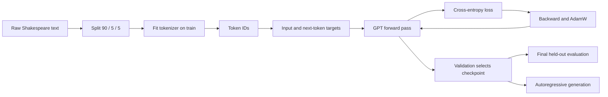

# Learn the project, one step at a time

This guide explains **what each part does, why it exists, how to run it, and how to
check your understanding**. Read it with the code open. You do not need to understand
every PyTorch function before starting.

The task is next-token prediction. Given `To be`, the model assigns probabilities to
possible continuations. Training makes the probability of the real next token larger.
Repeating this operation creates text. It does not give the model access to facts,
reasoning tools, or a conversation history beyond its context window.

## 1. Understand the scope

We build a **small GPT-style decoder trained from random weights**. Its core layout
follows the GPT-2 family: learned token and position embeddings, causal self-attention,
pre-normalized residual blocks, and a language-model head. The original GPT-2 report
describes a much larger family trained on a different corpus; our checkpoints are not
compatible with OpenAI's pretrained weights. [GPT-2 report](https://cdn.openai.com/better-language-models/language_models_are_unsupervised_multitask_learners.pdf)

“From scratch” has a precise meaning here. We implement the tokenizer, attention
equations, transformer composition, training loop, evaluation, and sampling. PyTorch
provides tensor operations, primitive layers, autograd, and AdamW. We do not implement
matrix multiplication kernels or the automatic differentiation engine.

The complete pipeline is:



**Explain it aloud:** “My model learns a conditional probability distribution over the
next token. I train on one partition and measure its predictions on held-out text.”

## 2. Use the correct Python environment

A virtual environment is a project-specific set of installed Python packages. It keeps
this project independent from other projects on your computer.

On the computer where this project was built, `.venv` already exists. From the project
folder in PowerShell, you can run commands directly without changing execution policy:

```powershell
.\.venv\Scripts\python.exe scripts/check_environment.py
```

Every command written as `python ...` below can use `.\.venv\Scripts\python.exe ...`
instead. Alternatively activate the environment:

```powershell
.\.venv\Scripts\Activate.ps1
python --version
```

For a fresh checkout on another computer, install Python 3.11 or 3.12 first, then:

```powershell
py -3.12 -m venv .venv
.\.venv\Scripts\python.exe -m pip install torch==2.7.1 --index-url https://download.pytorch.org/whl/cpu
.\.venv\Scripts\python.exe -m pip install -r requirements-dev.txt
.\.venv\Scripts\python.exe -m pip install -e . --no-deps
.\.venv\Scripts\python.exe scripts/check_environment.py
```

On Linux/macOS, use `python3.12 -m venv .venv` and `source .venv/bin/activate`, then the
same `python -m pip` commands. The recorded runs use CPU PyTorch 2.7.1; for an NVIDIA
GPU, choose a compatible CUDA build from the [official installer](https://pytorch.org/get-started/locally/).
Do not infer GPU availability from a package name alone: check the environment script.

`pip install -e .` means “install this project in editable mode.” It makes the package
inside `src/gpt2_scratch` importable from the scripts without copying the source.

**Success check:** the environment script prints versions, device, and
`Forward/backward OK`. A forward pass predicts; a backward pass computes derivatives.

## 3. Download and inspect the data

```powershell
python scripts/download_data.py
```

The file contains 1,115,394 bytes. The download script checks its SHA-256 fingerprint.
If even one byte changes, the expected fingerprint no longer matches. This catches
accidental edits or an upstream replacement.

Tiny Shakespeare is a **subset** of Shakespeare's works distributed with char-rnn,
as described in the [source repository](https://github.com/karpathy/char-rnn/blob/master/Readme.md).

We split the text before learning anything from it:

| Partition | Characters | Purpose |
|---|---:|---|
| Training | 1,003,854 | Learn tokenizer merges and model weights |
| Validation | 55,770 | Monitor progress and select the best checkpoint |
| Test | 55,770 | Evaluate the chosen checkpoint after training |

The partitions are contiguous. We do not randomly split overlapping windows: neighboring
windows would contain nearly the same text, producing overly optimistic evaluation.
Each partition is encoded separately, so no training window crosses into validation.

**Important limit:** this is a reproducible educational split, not proof that passages,
phrases, or plays are independent. It is not a standard external benchmark.

**Check your understanding:** why would “training on 90% of shuffled windows” leak more
information than “splitting the original text into separate sections”?

## 4. Turn text into numbers

Read `src/gpt2_scratch/tokenizer.py`.

### Character baseline

```powershell
python scripts/prepare_data.py --tokenizer char
```

The training text has 65 distinct characters. Each gets one integer ID. The actual
assignment is sorted and deterministic. The example `a -> 0, b -> 1` describes the idea;
it is not this dataset's actual assignment.

The model does not treat a larger ID as a more important character. IDs are indices
into a learned embedding table. The character tokenizer explicitly rejects a character
it has never seen, rather than silently replacing it.

### Byte-pair encoding (BPE)

```powershell
python scripts/prepare_data.py --tokenizer bpe --vocab-size 512
```

Our BPE begins with all 256 possible bytes. It counts adjacent pairs in training text,
merges the most frequent pair into a new token, and repeats. Starting from 256 bytes,
a requested vocabulary of 512 allows 256 learned merges. Frequency ties use a defined
ordering so repeated training produces the same tokenizer.

For the toy string `banana banana`, the first merge is `a` + `n`:

```text
Before: b a n a n a
After:  b [an] [an] a
```

Repeatedly occurring fragments become single tokens. The code groups words, whitespace,
and punctuation before applying merges, reducing the cost of fitting. This is a
deliberately simplified pretokenizer, not GPT-2's exact regular expression or vocabulary.
The underlying merge idea is described by [Sennrich et al.](https://aclanthology.org/P16-1162/).

Here, BPE encodes the training split into 627,274 tokens instead of 1,003,854 characters:
about 1.60 characters per token. A 128-token BPE context therefore usually covers more
text than a 128-token character context.

Bytes allow unseen UTF-8 input, including accents and emoji, to round-trip. Arbitrary
generated byte sequences can still be invalid UTF-8; decoding replaces invalid sequences.

Preparation writes arrays, the tokenizer, and a manifest into `data/processed/<kind>`.
It refuses to overwrite a nonempty directory. For a new vocabulary experiment, use
`--out data/processed/bpe-768`.

**Check your understanding:** BPE learns which fragments become tokens; the GPT model
then learns which token is likely next. These are two separate learning processes.

## 5. Build input and target sequences

```powershell
python scripts/inspect_batch.py --data data/processed/char --tokens 16
python scripts/inspect_batch.py --data data/processed/bpe --tokens 16
```

If a tiny encoded sequence is `[10, 20, 30, 40]`, a three-position training example is:

```text
Input x:  [10, 20, 30]
Target y: [20, 30, 40]
```

At the first position, predict `20` from `10`. At the second, predict `30` from
`10, 20`. At the third, predict `40` from `10, 20, 30`.

`batch_size = 16` means processing 16 examples together. `block_size = 128` means each
example has 128 input tokens. One update scores `16 × 128 = 2,048` target tokens.
Sampling is with replacement: a training window can be selected more than once.

This explains the common tensor notation:

| Symbol | Meaning | CPU run |
|---|---|---:|
| B | Batch size | 16 |
| T | Sequence length | 128 |
| C | Embedding width | 128 |
| H | Attention heads | 4 |
| d | Width per head, C/H | 32 |
| V | Vocabulary size | 65 or 512 |

**Exercise:** write the input and targets for `[3, 7, 2, 9, 4]` with block size four.

## 6. Follow the model's forward pass

Read `src/gpt2_scratch/model.py` in this order: `GPT`, `TransformerBlock`,
`CausalSelfAttention`, then `FeedForward`.

### Embeddings

`token_embedding` has shape `[V, C]`. Looking up IDs of shape `[B, T]` produces
`[B, T, C]`. `position_embedding` adds a learned vector for each position, so order
is represented. Without positional information, the attention calculation alone
would not distinguish all token orders in the intended way.

### Attention: information moves between positions

From each token representation, a linear projection produces three vectors:

- **Query:** what this position is looking for.
- **Key:** what a position offers for matching.
- **Value:** the information that will be combined.

These are useful intuitions, not manually assigned linguistic labels. Their values
are learned through the training objective.

For each head, the code computes:

```text
scores  = (Q @ K.transpose(-2, -1)) / sqrt(d)
weights = softmax(scores + causal_mask)
output  = weights @ V
```

The dot product compares queries and keys. Scaling by `sqrt(d)` controls the magnitude
before softmax. Softmax converts scores into positive weights that sum to one.
Multiplying by values forms a weighted combination of earlier information. These
operations follow [scaled dot-product attention](https://arxiv.org/abs/1706.03762).

The causal mask is essential:

```text
Position can read ->   0  1  2  3
                  0   ✓  ×  ×  ×
                  1   ✓  ✓  ×  ×
                  2   ✓  ✓  ✓  ×
                  3   ✓  ✓  ✓  ✓
```

The diagonal is allowed because the token at position `t` predicts the token at `t+1`.
Future scores become negative infinity, whose softmax probability is zero.

Four heads do this using four learned subspaces. Their outputs are concatenated and
projected back to width C. A head is not guaranteed to learn an interpretable role.

The default `manual` backend exposes the math. `sdpa` uses PyTorch's equivalent API.
It may select different kernels depending on hardware; selecting `is_causal=True`
does not guarantee Flash Attention. [PyTorch SDPA documentation](https://docs.pytorch.org/docs/stable/generated/torch.nn.functional.scaled_dot_product_attention.html)

### Residual connections, normalization, and the MLP

Each block performs:

```text
x = x + attention(layer_norm(x))
x = x + mlp(layer_norm(x))
```

A residual connection adds the block's update to its input. Layer normalization
normalizes features within each token representation. The feed-forward network
expands width 128 to 512, applies GELU, and projects back to 128. Attention mixes
positions; the MLP transforms each position's features.

The CPU models stack four blocks. A final normalization and output projection produce
logits with shape `[B, T, V]`. Logits are scores before converting to probabilities.

The output projection shares weights with the token embedding table. This is called
**weight tying**. The same parameter is counted once and optimized once.

**Check your understanding:** why would removing the causal mask make training loss
misleadingly low? The model could inspect the answer token in a later input position.

## 7. Understand the loss and optimizer

Cross-entropy measures how surprised the model is by the correct target:

```text
loss = -mean(log(probability assigned to the correct next token))
```

If the correct token gets probability 0.5, its loss is about 0.693 nats. If it gets
0.01, the loss is about 4.605 nats. Lower is better on held-out data.

`loss.backward()` applies the chain rule to compute a gradient for every learned
parameter. A gradient tells the optimizer how a small parameter change affects loss.
`optimizer.step()` uses those gradients to update parameters.

The training loop includes:

- **AdamW:** maintains moving statistics of gradients and applies weight decay.
- **Warmup:** raises the learning rate over the first 100 updates.
- **Cosine decay:** gradually lowers it to the configured minimum.
- **Gradient clipping:** caps the combined gradient norm before the update.
- **Dropout:** randomly removes some activations during training; disabled during evaluation.

The default CPU learning rate peaks at 0.001. A learning rate that is too high can
make training unstable; too low can make progress slow. Weight decay is applied to
matrix parameters, excluding biases and normalization vectors in this implementation.

**Exercise:** after understanding the reference run, make a new config with a different
learning rate and write a hypothesis before running it. Keep the test set untouched.

## 8. Prove the machinery works before a long run

```powershell
python -m pytest -q
python -m ruff check .
python -m ruff format --check .
python train.py --config configs/smoke.json --out runs/my-smoke
```

Tests check more than output shapes. They verify that the tokenizer round-trips Unicode,
future tokens cannot affect earlier logits, manual and optimized attention agree in
both outputs and gradients, a tiny batch can be overfit, and checkpoint resume reproduces
an uninterrupted CPU run exactly in the tested environment.

The smoke config uses only 30 updates. Its role is to catch broken plumbing quickly.
It is not evidence of a high-quality language model.

If running inside the Windows Codex sandbox, a local test temp directory can avoid
the system temporary-directory issue:

```powershell
New-Item -ItemType Directory -Force .local
python -m pytest -q --basetemp=.local/pytest-temp
```

## 9. Run a full experiment

```powershell
python scripts/benchmark.py --config configs/char_cpu.json --steps 20
python train.py --config configs/char_cpu.json --data data/processed/char --out runs/my-char
python train.py --config configs/bpe_cpu.json --data data/processed/bpe --out runs/my-bpe
```

The benchmark estimates update time on your actual computer. It does not include all
evaluation or saving overhead. Runtime varies with hardware, background applications,
thread settings, and temperature; the supplied brief's runtime is not a guarantee.

Every 250 updates, training estimates losses on the same fixed evaluation windows.
Training uses a separate random generator, so evaluation does not alter the sequence
of training batches. The lower validation loss selects `best.pt`.

Read these outputs:

| Artifact | What it means |
|---|---|
| `metadata.json` | Architecture, training settings, versions, hardware, data and source hashes |
| `metrics.jsonl` | One JSON event per log/evaluation record |
| `best.pt` | Best validation checkpoint, used for final evaluation and sampling |
| `last.pt` | Most recently saved state, used to resume training |
| `summary.json` | Completion status, best step, tokens processed, and measured runtime |
| `tokenizer.json` | Vocabulary or BPE merges used by this run |

For a planned pause without changing the experiment's learning-rate schedule:

```powershell
python train.py --config configs/char_cpu.json --out runs/resume-example --stop-after 500
python train.py --config configs/char_cpu.json --out runs/resume-example --resume runs/resume-example/last.pt
```

A checkpoint contains model weights, AdamW state, update number, random states, and
configuration. Restoring only weights would not restore the same training trajectory.
Resume checks that the config, data, tokenizer, and training source are unchanged.
After an unexpected interruption, updates since the last saved checkpoint must be rerun.

The exact-resume test is a CPU test in one environment. Seeds cannot promise identical
results across all devices and library versions. [PyTorch reproducibility notes](https://docs.pytorch.org/docs/stable/notes/randomness.html)

## 10. Evaluate honestly

After training and checkpoint selection:

```powershell
python evaluate.py --checkpoint runs/my-char/best.pt --data data/processed/char --split both
python evaluate.py --checkpoint runs/my-bpe/best.pt --data data/processed/bpe --split both
```

This full evaluation scores every next-token target once, including a short final
block. Context resets at each 128-token block. The first token of the partition is
context and is not scored. This differs from the sampled validation estimate used
during training, so their reported losses need not be identical.

The comparison includes uniform guessing, a smoothed unigram model, and a smoothed
bigram model. A unigram uses token frequency. A bigram uses only the preceding token.
All are fitted only on the training partition and scored on the same targets as GPT.

**Perplexity = exp(cross-entropy).** It is a measure of predictive uncertainty, not an
accuracy percentage or the number of words the model understands.

Do not directly compare character perplexity with BPE perplexity: one token represents
different amounts of text. We also report negative log likelihood normalized by scored
UTF-8 bytes, in bits per byte. Even then, these runs are not a controlled tokenizer
ablation: their vocabulary matrices differ, BPE sees more text per context, and 2,500
updates expose different amounts of raw text.

One training seed is evidence of a working experiment, not a statistical robustness
study. Test results describe this held-out slice, not general language ability.

## 11. Generate new text

```powershell
python generate.py --checkpoint runs/my-char/best.pt --prompt "ROMEO:" --tokens 300 --seed 42
python generate.py --checkpoint runs/my-bpe/best.pt --prompt "First Citizen:" --temperature 0.8 --top-k 40
```

The model encodes the prompt, predicts next-token scores, samples one token, appends
it, and repeats. A long prompt is cropped to the latest context window for each
prediction; the returned text still includes the full original prompt.

Temperature divides the logits. Lower positive temperatures concentrate probability
on preferred tokens. Higher temperatures spread it out. Top-k limits sampling to the
k highest-scoring tokens. A fixed seed makes sampling repeatable in the same environment.

Try temperature 0.6, 0.8, and 1.0 with the same prompt and seed. Notice repetition,
spelling, formatting, and coherence. A convincing-looking speaker label is not proof
that the model can sustain a meaningful scene.

## 12. Present the project to recruiters

Start with the [results](RESULTS.md), then show one meaningful test and one design tradeoff.
The best demonstration is a short explanation followed by a command that reproduces it.
Use the [interview guide](INTERVIEW_GUIDE.md) to practice, and the
[publishing guide](GITHUB_PUBLISH.md) to upload the repository.

Before presenting, make sure you can:

- Trace `[B,T]` token IDs to `[B,T,V]` logits.
- Explain the one-token target shift and causal mask.
- Explain why the tokenizer is fitted on training text only.
- Distinguish validation selection from final test evaluation.
- Explain why a checkpoint needs optimizer and random states.
- Interpret a loss curve without calling lower loss “accuracy.”
- Describe two limitations of the text the model produces.

Suggested learning sessions: environment/data/tokenization; attention/math; training/
debugging; evaluation/generation; then a five-minute recorded demonstration. After that,
run one small experiment you design yourself and record what you learned.
