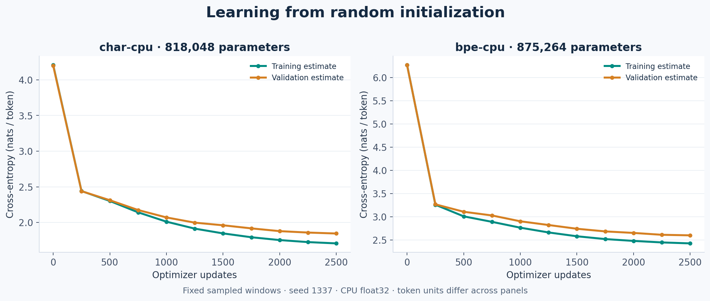

# GPT-2 from scratch

A small GPT-style language model in PyTorch, trained from random initialization on
Tiny Shakespeare. The implementation includes causal multi-head attention, byte-pair
encoding, a training loop with checkpoint recovery, and held-out evaluation against
statistical baselines.

The reference models have fewer than one million parameters. They follow GPT-2's
decoder architecture, but use a different scale, tokenizer, and training corpus.
There are no pretrained weights to download; train a model before generating text.

## Install

Use Python **3.11 or 3.12**. From a fresh checkout:

```bash
git clone https://github.com/bdjjo/ai-engineering-projects.git
cd ai-engineering-projects/projects/01-gpt2-from-scratch
python3.12 -m venv .venv
source .venv/bin/activate
```

On Windows PowerShell, create and activate the environment with:

```powershell
py -3.12 -m venv .venv
.\.venv\Scripts\Activate.ps1
```

Install the CPU dependencies:

```bash
python -m pip install torch==2.7.1 --index-url https://download.pytorch.org/whl/cpu
python -m pip install -r requirements.txt
python -m pip install -e . --no-deps
python scripts/check_environment.py
```

For CUDA, use the matching PyTorch 2.7.1 command from the
[PyTorch installation selector](https://pytorch.org/get-started/locally/) before
installing the remaining requirements.

## Train and generate

All commands below run from this project folder. Start with the character tokenizer:

```bash
python scripts/download_data.py
python scripts/prepare_data.py --tokenizer char
python train.py --config configs/smoke.json --out runs/smoke
```

The smoke preset runs 30 updates to check the pipeline. For a useful training run:

```bash
python train.py --config configs/char_cpu.json --out runs/char
python generate.py --checkpoint runs/char/best.pt --prompt "ROMEO:" --tokens 300 --seed 42
python evaluate.py --checkpoint runs/char/best.pt --data data/processed/char --split val
```

To train with a 512-token byte BPE vocabulary:

```bash
python scripts/prepare_data.py --tokenizer bpe --vocab-size 512
python train.py --config configs/bpe_cpu.json --data data/processed/bpe --out runs/bpe
python generate.py --checkpoint runs/bpe/best.pt --prompt "ROMEO:" --tokens 300 --seed 42
```

Prepare each data directory once. Use a new `--out` directory for each fresh run.
Checkpoints, logs, the tokenizer, and run metadata are saved there. `best.pt` holds
the lowest sampled validation loss; `last.pt` supports recovery after an interruption:

```bash
python train.py --config configs/char_cpu.json --out runs/char --resume runs/char/last.pt
```

Resume requires the same configuration, data, and training source. Keep the test
partition for final evaluation after making decisions on validation:

```bash
python evaluate.py --checkpoint runs/char/best.pt --data data/processed/char --split both
```

| Preset | Purpose |
|---|---|
| `configs/smoke.json` | 30-update CPU pipeline check |
| `configs/char_cpu.json` | Character model, 2,500 updates |
| `configs/bpe_cpu.json` | Byte BPE model, 2,500 updates |
| `configs/gpu.json` | Larger CUDA experiment using PyTorch SDPA; unbenchmarked |

## Results

Both reference runs use 4 layers, 4 attention heads, width 128, a 128-token context,
and seed 1337. Training used CPU float32, PyTorch 2.7.1, and four threads on Windows.

| Tokenizer | Parameters | Test loss (nats/token) ↓ | Test bits/byte ↓ | Bigram bits/byte ↓ | Wall time |
|---|---:|---:|---:|---:|---:|
| Character | 818,048 | 1.8920 | 2.730 | 3.592 | 9.18 min |
| Byte BPE | 875,264 | 2.7132 | 2.502 | 3.014 | 9.67 min |



These are single-seed results. Token loss is not directly comparable across tokenizers;
bits per byte uses a common unit, but the models still differ in parameter count,
text exposure, and context coverage. Generated text learns dialogue formatting and
some vocabulary, with frequent grammatical errors and repetition.

The [evaluation protocol](docs/RESULTS.md), [raw reports](reports/README.md), and
[unedited samples](reports/char-cpu/samples.txt) document what was measured. To export
reports for your own runs, install `requirements-dev.txt` and run:

```bash
python scripts/export_report.py --runs runs/char runs/bpe --out reports/my-experiments
```

## Implementation

`src/gpt2_scratch/model.py` contains pre-normalized transformer blocks, explicit
Q/K/V projections and causal masking, GELU MLPs, learned position embeddings, and
tied input/output weights. PyTorch provides tensors, autograd, primitive layers,
and AdamW. An optional SDPA attention path is tested against the manual implementation.

The other modules cover tokenization, data preparation, training, generation, and
evaluation. Data is split before tokenizers are fitted. Run metadata records the
configuration, environment, data fingerprints, and training source hashes.

## Tests

```bash
python -m pip install -r requirements-dev.txt
python -m pytest -q
python -m ruff check .
python -m ruff format --check .
```

The 37 tests cover tokenizer round trips, data isolation, causal attention, gradients,
overfitting a tiny batch, full-split scoring, generation, and exact CPU checkpoint
recovery. [CI](https://github.com/bdjjo/ai-engineering-projects/actions/workflows/ci.yml)
runs on Ubuntu with Python 3.11/3.12 and Windows with Python 3.12.

See the [model card](docs/MODEL_CARD.md) for scope and limitations, and
[troubleshooting](docs/TROUBLESHOOTING.md) for common setup errors.

## References

- [GPT-2 technical report](https://cdn.openai.com/better-language-models/language_models_are_unsupervised_multitask_learners.pdf)
- [Attention Is All You Need](https://arxiv.org/abs/1706.03762)
- [Byte-pair encoding for subword units](https://aclanthology.org/P16-1162/)
- [Tiny Shakespeare data](https://github.com/karpathy/char-rnn/tree/master/data/tinyshakespeare)

Code: [MIT](LICENSE).
