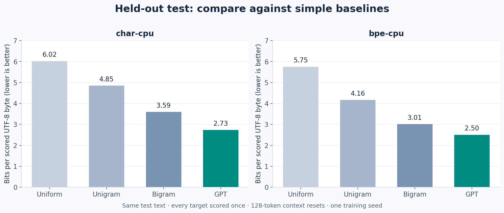

# Results

Two small GPT models trained on Tiny Shakespeare outperform their respective bigram
baselines on held-out text. All measurements below come from completed CPU runs.

## Setup

Both runs use 4 layers, 4 heads, width 128, context 128, batch size 16, and 2,500
AdamW updates with seed 1337. Each processes 5,120,000 training target tokens. The
learning rate warms up for 100 updates, then decays from 0.001 to 0.0001. Dropout
and weight decay are 0.1; gradient clipping is 1.0.

Environment: Windows, Python 3.12.14, PyTorch 2.7.1+cpu, float32, four threads,
manual attention. Wall time includes evaluation and checkpoint saves; measurements
were taken during normal desktop use. Full settings and source hashes are recorded
in the [character](../reports/char-cpu/metadata.json) and
[BPE](../reports/bpe-cpu/metadata.json) metadata.

| Run | Vocabulary | Parameters | Best update | Wall time |
|---|---:|---:|---:|---:|
| Character | 65 | 818,048 | 2,500 | 9.18 min |
| Byte BPE | 512 | 875,264 | 2,500 | 9.67 min |

## Held-out test results

| Tokenizer | Model | Loss (nats/token) ↓ | Perplexity ↓ | Bits/byte ↓ |
|---|---|---:|---:|---:|
| Character | Uniform | 4.1744 | 65.000 | 6.022 |
| Character | Unigram | 3.3620 | 28.846 | 4.850 |
| Character | Bigram | 2.4895 | 12.056 | 3.592 |
| Character | GPT | **1.8920** | **6.632** | **2.730** |
| Byte BPE | Uniform | 6.2383 | 512.000 | 5.752 |
| Byte BPE | Unigram | 4.5166 | 91.519 | 4.165 |
| Byte BPE | Bigram | 3.2686 | 26.274 | 3.014 |
| Byte BPE | GPT | **2.7132** | **15.078** | **2.502** |

Perplexity is the exponential of mean token cross-entropy. Its token units differ
between these runs, so compare byte-normalized loss when reading across tokenizers.
Bits per byte is total negative log likelihood divided by scored UTF-8 bytes and
converted from nats to bits.

## Protocol

The verified source text is split contiguously into 90% training, 5% validation, and
5% test before fitting either tokenizer. Training samples windows from the training
partition only. Fixed validation windows select the best checkpoint.

Final evaluation scores every next-token target once, resetting context at each
128-token block and including the partial final block. The first token is context
only. Both test evaluations score 55,769 bytes: 55,769 character tokens or 35,644
BPE tokens. This protocol differs from scoring every position with a full sliding
context. Unigram and bigram baselines use add-one smoothing, fit on training tokens,
and score the same held-out targets.

## Interpretation

The BPE model has lower bits per byte in this experiment, but also has more parameters,
more text per context, and greater text exposure for the same number of training
tokens. One seed does not establish a general tokenizer advantage. The literary
corpus also contains repeated phrases; the split is not deduplicated or grouped by play.

Samples show speaker labels and recognizable vocabulary alongside misspellings,
repetition, and broken syntax. All three predefined prompts are retained without
editing or rejection: [character outputs](../reports/char-cpu/samples.txt),
[BPE outputs](../reports/bpe-cpu/samples.txt), and the
[sampling settings](../reports/sample_plan.json).

To reproduce the runs, follow the [training commands](../README.md#train-and-generate)
with fresh output directories. The [raw logs and evaluation files](../reports/README.md)
contain unrounded measurements. Direct dependency pins are in `requirements-dev.txt`;
the original Windows environment is recorded in `requirements-lock-windows-py312.txt`.
GPU training and throughput have not been measured.
