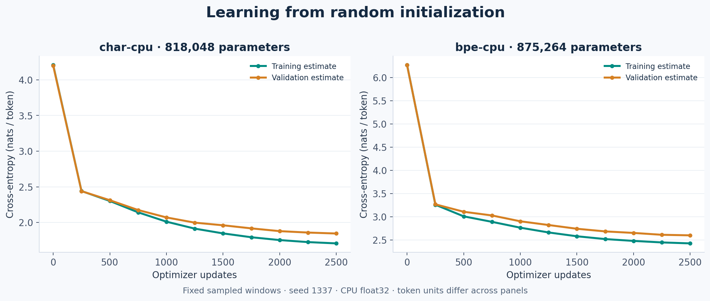
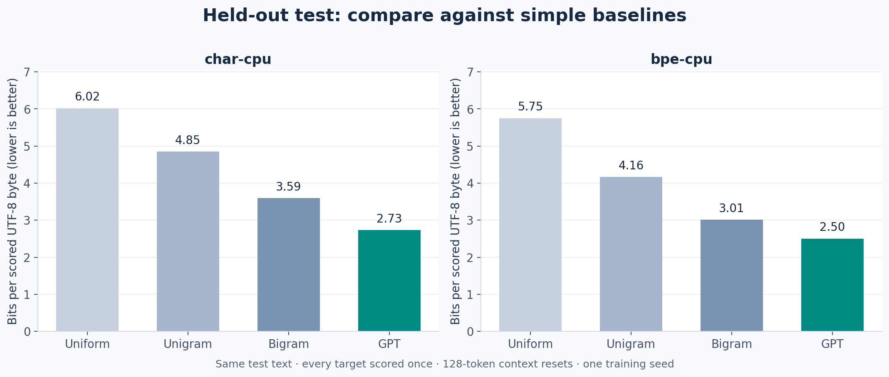

# Measured experiment summary

Generated from completed local runs by `scripts/export_report.py`.

| Run | Parameters | Updates | Best sampled val loss | Test loss | Test perplexity | Test bits/byte | Wall minutes |
|---|---:|---:|---:|---:|---:|---:|---:|
| char-cpu | 818,048 | 2,500 | 1.8462 | 1.8920 | 6.632 | 2.730 | 9.18 |
| bpe-cpu | 875,264 | 2,500 | 2.6027 | 2.7132 | 15.078 | 2.502 | 9.67 |

Perplexities use different token units and must not be compared directly.
These runs are a descriptive comparison, not a controlled tokenizer ablation.

