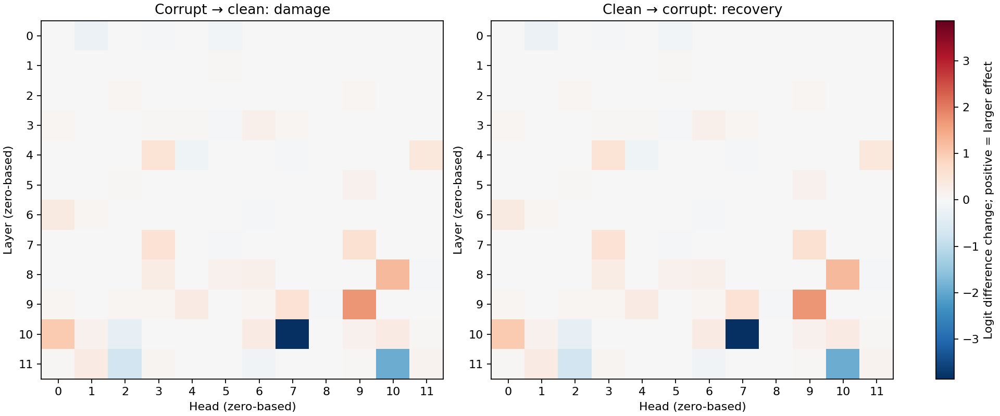
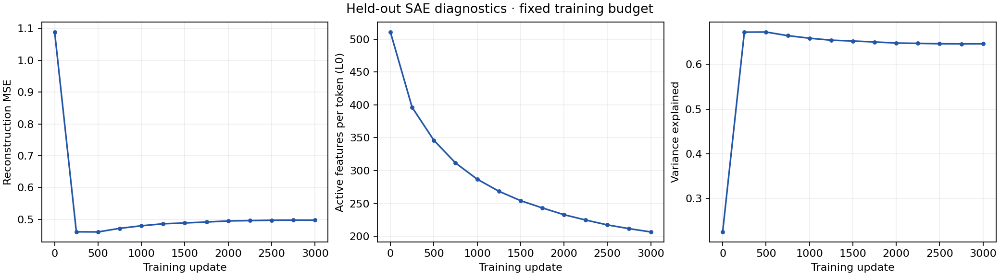

# Measured CPU experiments

These experiments were executed locally on 20 November 2026 with Python
3.12.14, PyTorch 2.7.1+cpu,
TransformerLens 2.15.4, float32 model
computation, and four CPU threads. They use pretrained GPT-2 Small, not Project 1's
small model trained from scratch. The larger GPU preset has not been run.

## IOI head interventions

The 16 generated prompts use four name pairs and two settings, balancing both
orders. The recipient has a higher score than the subject on **16/16** clean prompts.
This is pairwise name accuracy, not top-1 accuracy over the entire vocabulary.

- Mean clean recipient-minus-subject logit difference: **3.8115**.
- Mean corrupt difference, using the same clean answer IDs: **-3.8115**.
- Maximum identical-source patch control error: **0.0**.
- Sweep wall time, excluding model loading: **242.5 seconds**.

Largest **decreases** in clean score after substituting a corrupt head output:

| Layer | Head | Damage in logits |
|---:|---:|---:|
| 9 | 9 | 1.7135 |
| 8 | 10 | 1.2567 |
| 10 | 0 | 1.0133 |
| 7 | 9 | 0.5900 |
| 7 | 3 | 0.5615 |

Layer 10, head 7 has damage **-3.8566**: this intervention
increased the score. Its absolute effect is larger than the largest positive
damage. Signed effects must be interpreted in their intervention context; negative
effects should not be discarded as unimportant.



Each head is patched at every sequence position. Balanced reverse-name prompts
make average damage and recovery equivalent, up to numerical error. They are not
independent replications. The sample is small, symmetric, and from one prompt
family. A strong effect does not establish a head's computational role or recover
the full circuit in [Wang et al.](https://arxiv.org/abs/2211.00593).

## SAE experiments

All runs use identical layer-8 residual activations, seed 1337, 1,024 features,
learning rate 0.0003, batch size 128, and sampling with replacement. Training uses
**8,192** tokens from WikiText-2's official train split; evaluation uses **2,048**
tokens from its validation split. Context prefixes are at most 128 tokens and
exclude BOS. Activations are stored as float16 and converted to float32 for training.
Exact normalized-text overlap is excluded; related passages may remain.

| L1 coefficient | Updates | Validation MSE per dimension | Variance explained | L0 | Inactive on validation | Training wall time |
|---:|---:|---:|---:|---:|---:|---:|
| 0.01 | 500 | 0.1616 | 88.50% | 777.2 | 0.0% | 9.5 s |
| 1.0 | 500 | 0.4605 | 67.22% | 346.2 | 0.0% | 25.6 s |
| 5.0 | 500 | 0.9329 | 33.60% | 62.8 | 0.0% | 10.8 s |
| 1.0 | 3,000 | 0.4975 | 64.59% | 206.6 | 0.0% | 54.9 s |

The 0.01 run reconstructs well but is dense. The coefficient-5 run is much sparser
but loses substantial reconstruction fidelity. After this comparison, coefficient
1 was chosen for a 3,000-update follow-up. It uses roughly 20% of the available
features per token; it does not reach the original brief's suggested 15–25 active
features or 85% variance explained. Those numbers were not guaranteed outcomes.

The longer coefficient-1 run supplies the browser. It was chosen for a moderate
reconstruction/sparsity tradeoff, not the best reconstruction score. Its checkpoint
is the final fixed-budget state. Validation informed the experiment choices, and
there is **no untouched final test evaluation or multi-seed uncertainty estimate**.
No feature resampling or language-model loss recovery measurement is implemented.



The saved training-only activation scale is **2.73249563**. Variance explained
uses a global squared-error ratio with the training per-dimension mean as its
baseline. Inactive fraction covers all validation tokens and is not a claim that
features never activate elsewhere. The loss uses dimension sums, so L1 coefficients
cannot be compared directly with a feature-mean or dimension-mean objective.

## Feature browser

The browser contains **1,024 features** indexed over **781 tokens**
in 32 original, AI-assisted probe paragraphs. Up to four distinct-paragraph
examples are retained per feature, from a bounded top-candidate pool. These are
exploratory contexts, not independently validated feature meanings. No semantic
labels are assigned. The SAE features have not been linked causally to IOI behavior.

The Gradio app was launched locally and feature selection was checked on screen.
The Hugging Face package is prepared for `bdjjo/gpt2-feature-explorer`.
**Public Space deployment remains pending account authentication.** This report
does not claim that a public Space is live.

## Reproduce and audit

Fifteen Project 3 behavioral tests pass. The existing projects' 37 and 15 tests
also pass. The live browser responds over HTTP, returns different feature examples,
and rejects out-of-range indices. The default private notebook walkthrough executes
in a real Jupyter kernel. [Verification details](../reports/cpu-pilot/verification.json)
distinguish these checks from the unexecuted Colab/Drive and CUDA paths.

Model revision: `607a30d783dfa663caf39e06633721c8d4cfcd7e`.
Dataset revision: `b08601e04326c79dfdd32d625aee71d232d685c3`.
Model processing: layer-norm folding and writing-weight/unembedding centering are
enabled; factored attention refactoring is disabled. Collection, training, and
feature export share this convention. `blocks.8.hook_resid_post` is after block 9.

```bash
python run_ioi.py --batch-size 2 --revision 607a30d783dfa663caf39e06633721c8d4cfcd7e
python collect_activations.py --revision 607a30d783dfa663caf39e06633721c8d4cfcd7e --dataset-revision b08601e04326c79dfdd32d625aee71d232d685c3
python train_sae.py --config configs/cpu-reference.json --out outputs/sae
python export_features.py --checkpoint outputs/sae/sae_final.pt
```

To repeat the three shorter runs, use `configs/cpu-pilot.json`,
`configs/cpu-sparse.json`, and `configs/cpu-sparse-5.json` with different `--out`
directories. Keep the same activation cache. The GPU preset uses a different corpus,
width, batch size, and budget, and is not directly comparable to this table.

[Raw IOI effects](../reports/cpu-pilot/ioi_results.json),
[SAE summaries and histories](../reports/cpu-pilot/sae_comparisons),
[comparison CSV](../reports/cpu-pilot/sae_comparison.csv),
[reference checkpoint metadata](../reports/cpu-pilot/sae_summary.json), and
[feature index](../reports/cpu-pilot/feature_index.json) preserve the measurements.
Model and activation weights remain local. The summaries include data hashes,
checkpoint hashes, package versions, and full configurations. Exact numeric results
can vary with hardware and library versions.
