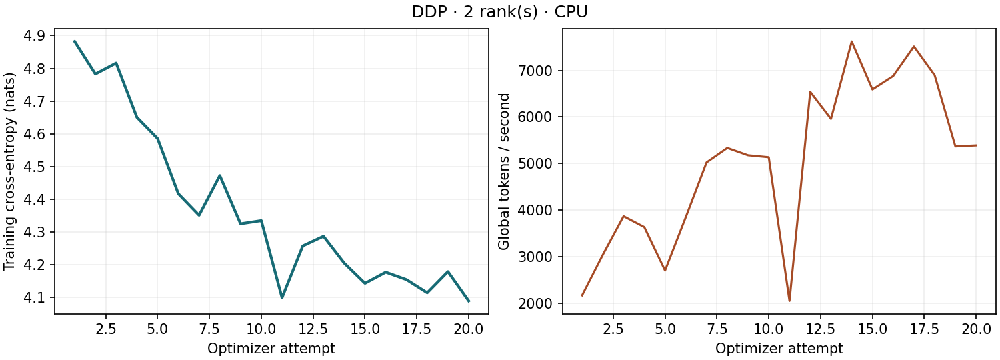

# Distributed GPT Training

A PyTorch training lab with single-device, DDP, and FSDP execution, activation
checkpointing, mixed precision, recoverable asynchronous checkpoints, and explicit
throughput/MFU accounting. FSDP `FULL_SHARD` shards parameters, gradients, and AdamW
state (the ZeRO-3 style of sharding); this project does not use DeepSpeed.

**Measured so far:** CPU training, real two-rank Gloo/DDP, exact CPU distributed
checkpoint recovery, a CPU profiler trace, and a resumed 124M T4/FP16 pilot at
3,901 timed tokens/s and 4.62% estimated MFU. **Pending:** exact GPU recovery
comparison, multi-GPU FSDP validation, and the 1.313B run. See [results](docs/RESULTS.md).



## Install

Use Python 3.11 or 3.12 in a dedicated environment. From this project directory:

```bash
python -m venv .venv
# Linux: source .venv/bin/activate
# PowerShell: .\.venv\Scripts\Activate.ps1
python -m pip install torch==2.7.1 --index-url https://download.pytorch.org/whl/cpu
python -m pip install -r requirements-dev.txt
python -m pip install -e . --no-deps
```

For a CUDA machine, replace the first install command with the matching
[official PyTorch 2.7.1 CUDA wheel](https://pytorch.org/get-started/previous-versions/#v271),
for example `--index-url https://download.pytorch.org/whl/cu126`. This lab targets
the tested 2.7.1 APIs, including FSDP1 and Distributed Checkpoint. Check CUDA works
before launching training. Installing the CPU wheel in Colab disables GPU training.

## Run locally

```bash
python prepare_data.py --source synthetic --out data/synthetic
python train_distributed.py --config configs/cpu-smoke.json --data data/synthetic --out outputs/cpu
python scripts/verify_distributed.py --out outputs/distributed-verification
python -m pytest -q
python -m ruff check .
python -m ruff format --check .
```

The verifier launches **four real runs**: single process, two-process DDP, an
interrupted DDP run, and its continuation. It compares both model and AdamW tensors
at the same global batch. On Windows it uses a small subprocess launcher because
the 2.7.1 torchrun agent may request libuv even when that backend is absent.
Gloo workers still communicate through real localhost sockets. Linux uses torchrun.

All output paths must be fresh. Completed checkpoints contain a `COMPLETED.json`
marker; partial checkpoints are rejected. Datasets and weights are ignored by Git.

## One-GPU Colab pilot

Follow [the Colab commands](docs/COLAB.md). The pilot uses 123,767,040 parameters,
context 256, microbatch 1, four accumulation steps, and 20 optimizer attempts on a
small WikiText sample. `auto` selects FP16 with loss scaling on T4, or native BF16
on supported newer GPUs. This tests GPU execution and recovery; it cannot establish
multi-GPU sharding or scaling. The larger preset is not a recommended T4 starting point.

## Multi-GPU FSDP

On a Linux host with two or more CUDA GPUs, first run the tiny recovery check:

```bash
python scripts/verify_fsdp.py --out outputs/fsdp-check
```

After that passes, prepare data and run a short capacity check before longer training:

```bash
python prepare_data.py --source openwebtext --out data/openwebtext
torchrun --standalone --nproc_per_node=2 train_distributed.py \
  --config configs/fsdp-1b.json --strategy fsdp --device cuda \
  --data data/openwebtext --out outputs/fsdp-pilot --stop-after 10
```

The preset has **1,313,183,744** parameters, 24 layers, width 2,048, 16 heads,
context 1,024, microbatch 1/rank and accumulation 8. Its configured 5,000 attempts
are a schedule, not a completed experiment. Increase the data budget for a serious
language-model run: the default small sample repeats rapidly. Use
`scripts/inspect_model.py --config configs/fsdp-1b.json` for parameter and memory
estimates without allocating the model.

The implementation initializes a full FP32 model on each GPU before sharding.
It therefore needs about 5.25 GB/device just for initial parameters, and more
for training. The unsharded weights/gradients/Adam estimate is about 21.01 GB
before activations, temporary buffers, allocator overhead, or checkpoint staging.
FSDP is not a guarantee that a specific batch fits. There is no CPU offload or
meta-device distributed initialization in the training path.

## Recovery, profiling, and reports

```bash
# Continue to the ORIGINAL schedule's step 20, writing a fresh output directory.
python train_distributed.py --config configs/cpu-smoke.json --data data/synthetic \
  --out outputs/continued --resume outputs/cpu/checkpoints/step-000010

python train_distributed.py --config configs/cpu-smoke.json --data data/synthetic \
  --out outputs/profile --profile
python scripts/export_report.py --run outputs/profile --out outputs/profile-report
```

Resume requires the same model/train config, code hashes, data hashes, precision,
strategy, world size, and PyTorch version. Relaunch with the same number of workers.
It restores optimizer tensors, per-rank RNG, scaler, scheduler position, and data
cursor. Elastic world-size changes and cross-version checkpoints are not supported.

`--profile` captures attempts 3–4 per process after wait/warmup. Open the resulting
`trace-rank*.json` in Chrome's trace viewer or Perfetto. `profiler.txt` is sorted by
self CPU time; CUDA activities are also in GPU traces. Profiled timings include
instrumentation overhead; use separate unprofiled runs for throughput comparisons.

Each run writes config/source/data provenance, step history, summary, and sharded
checkpoints. The report exporter copies only metrics, a plot, and the profiler table.
See [design and measurement](docs/DESIGN.md) for formulas and timing boundaries.

## Layout

```text
configs/                    CPU, Colab, and 1.313B presets
src/distributed_gpt/         Model, data, distributed setup, checkpoints, metrics
scripts/                    Inspection, verification, report export
tests/                      CPU checks plus hardware-gated GPU checks
reports/                    Small measured artifacts; no model weights
docs/                       Results, Colab instructions, methodology
```

Code inherits the repository's [MIT license](../../LICENSE). Tokenized source data
is not redistributed. [WikiText's dataset card](https://huggingface.co/datasets/Salesforce/wikitext)
lists CC BY-SA 3.0/GFDL; consult source terms for other corpora. Data preparation
records immutable dataset/tokenizer revisions and file hashes.
