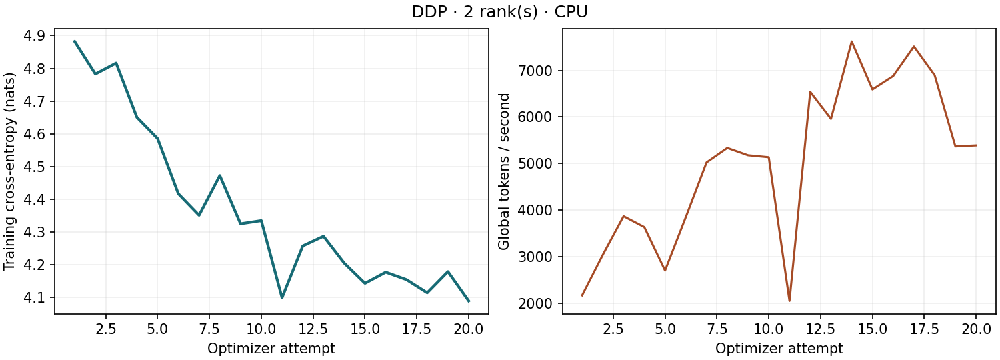

# Measured results

Recorded on 20 November 2026 using PyTorch 2.7.1+cpu and Python 3.12.14 on Windows.
The committed JSON contains the complete configurations, source/data SHA256 hashes,
and individual update measurements. These are short correctness experiments on
synthetic modular token sequences, not natural-language quality benchmarks.

## Training and recovery

Both runs use 109,184 unique parameters, context 32, two layers, width 64,
four heads, activation checkpointing, FP32, and 20 optimizer attempts. The
single-process run uses microbatch 2; DDP uses microbatch 1 on each of two ranks.
Accumulation is 2, yielding **128 global tokens/attempt** in both cases. Each rank
uses two CPU threads. Validation evaluates the same global examples.

| Measurement | Single CPU process | Two CPU DDP/Gloo ranks |
|---|---:|---:|
| Initial validation loss (nats/token) | 4.866973 | 4.866973 |
| Final validation loss (nats/token) | 4.089324 | 4.089323 |
| Timed global tokens/s, attempts 4–20 | 7,033 | 4,770 |
| Loop-wall tokens/s, including checkpoints | 5,473 | 3,547 |
| GPU MFU | Not measured | Not measured |
| GPU memory | Not measured | Not measured |

The DDP run is slower on this small CPU workload. This is one short run per
configuration on a shared laptop, without repetitions or confidence intervals.
It does not estimate GPU scaling. The earlier exploratory single-process run
also showed substantial timing variation under desktop load; the table uses the
paired verification run, not a selected average across experiments.

The maximum absolute difference across final model **and AdamW tensors** between
single-process and DDP training was **2.766028046607971e-7**. Stopping DDP at attempt
10 and resuming to attempt 20 produced **zero difference** from the uninterrupted
DDP run. A separate automated test verifies exact CPU recovery with dropout enabled.

- [Single-process metrics and history](../reports/cpu-single/results.json)
- [DDP metrics and history](../reports/cpu-ddp/results.json)
- [Distributed recovery comparison](../reports/distributed-verification.json)
- [Synthetic data provenance](../reports/synthetic-manifest.json)

## Profiling

A separate CPU run captured two active attempts after one waiting and one warmup
attempt. In that trace, `aten::mm` accounted for 17.68% of self CPU time and
`aten::native_layer_norm` for 5.65%. `ProfilerStep*` accounted for 20.25%, so the
table includes substantial framework/Python overhead at this tiny model size.
These percentages are CPU-only; they say nothing about NCCL or GPU kernel efficiency.

The [profiler table](../reports/cpu-profile/profiler.txt) and
[profiled run metrics](../reports/cpu-profile/results.json) are committed. Raw traces
remain in the ignored output directory and can be regenerated using `--profile`.
The profile's throughput is not used as the baseline benchmark.

## Validation status

Local suite: **24 passed, 2 skipped**. The skipped tests require CUDA and, for one
test, Linux with two GPUs. The suite covers causality, tied parameter accounting,
gradient accumulation, activation recomputation with dropout, rank batch separation,
data preparation, learning-rate endpoints, MFU units/aggregation, snapshot isolation,
exact recovery, and profiler export. The separate four-run DDP verifier also passed.
CI runs the suite and the real DDP verifier on Linux and Windows.

The real WikiText preparation path also completed: 131,072 training and 16,384
validation tokens with the GPT-2 tokenizer. Dataset revision
`b08601e04326c79dfdd32d625aee71d232d685c3` and tokenizer revision
`607a30d783dfa663caf39e06633721c8d4cfcd7e` are recorded in the
[preparation manifest](../reports/wikitext-preparation.json). This validates
tokenization/provenance; these tokens have not yet been used for a GPU run.

## What has not been measured

- The 123,767,040-parameter, one-GPU Colab pilot: prepared for execution.
- Mixed-precision GPU throughput, GPU MFU, and GPU peak memory.
- Multi-GPU FSDP, sharded CUDA optimizer recovery, and communication profiling.
- The 1,313,183,744-parameter preset or its configured 5,000-attempt schedule.
- Scaling, checkpoint speedups against synchronous saves, or language quality.

The billion-class preset has about 5.25 GB of FP32 parameters and a 21.01 GB
unsharded weights/gradients/Adam estimate before other memory. These are arithmetic
estimates, not observed GPU allocations. Example numbers in a project brief are
not included as measured results. See [Colab instructions](COLAB.md) for the next
experiment and [measurement definitions](DESIGN.md) for how results are computed.
