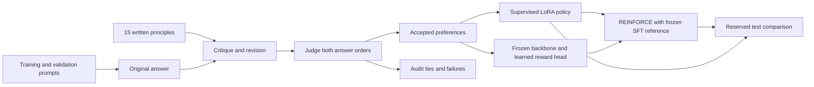

# Constitutional AI: from feedback to a trained policy

An answer can become more cautious without becoming more useful. I built this
project to make that trade-off visible: generate an answer, critique it against
written principles, check whether the revision is actually better, and use accepted
feedback to train a reward model and a language-model policy.

The implementation includes **15 principles, 72 authored prompts, a Bradley–Terry
reward objective, LoRA supervised fine-tuning, and an on-policy REINFORCE loop**.
The feedback, loss functions, training loops, and evaluation accounting are written
in Python/PyTorch. Pretrained language models, tokenizers, and LoRA layers come
from Transformers and PEFT.

**Status:** T4 feedback collection completed on 54 prompts: four accepted training
pairs and zero validation pairs. Real-data training is blocked by insufficient
valid preferences. The complete training path has passed an offline CPU integration test.
That test uses a random tiny model and scripted feedback. It proves that the stages
connect and update the intended parameters; it does not demonstrate improved safety.
See [measured results](docs/RESULTS.md) for the separate small-model feedback experiment
and the limits of the evidence.

## What I wanted to get right

The interesting part was deciding when feedback deserves to become training data.
A revision is not automatically the preferred answer. This pipeline lets the judge
prefer the original, accepts ties, and checks each preference again after swapping
the answers. A malformed judgment or disagreement stays in the audit and is excluded
from training. The same applies to empty, identical, or cut-off responses.

Prompts are assigned to train, validation, and test sets before generation. Model
selection uses validation data. Final evaluation compares both the SFT and RL
checkpoints with the original policy on reserved prompts, scoring safety and
helpfulness separately. Benign requests in sensitive domains test whether the
system has learned to refuse too broadly.



This is a small adaptation of [Bai et al., Constitutional AI](https://arxiv.org/abs/2212.08073).
It uses original-versus-revision comparisons, a frozen reward backbone, and sequence
REINFORCE. It does not reproduce the paper's models, preference mixture, or RL setup.
[Design notes](docs/DESIGN.md) describe the objective and the differences.

## Run locally

Use Python 3.11 or 3.12. From this directory:

```bash
python -m venv .venv
# Linux/macOS:
source .venv/bin/activate
# Windows PowerShell: .venv\Scripts\Activate.ps1

python -m pip install -r requirements-dev.txt
python -m pip install -e . --no-deps
python -m pytest -q
python scripts/smoke.py --out outputs/my-smoke.json
```

The tests and smoke run need no model downloads, API keys, or GPU. They exercise
pair filtering, response masking, padding-aware reward pooling, gradient direction,
adapter training/reload, generation limits, and evaluation coverage. Linux and
Windows checks are included in the repository's GitHub Actions workflow.

For a small **real-model feedback check**, download the public 135M SmolLM2 model:

```bash
python run_cai.py collect --config configs/cpu-feedback-pilot.json \
  --out outputs/cpu-feedback-check
```

This preset uses six generation prompts and reserves three test prompts. It is
designed to inspect whether a small model can provide usable feedback. Read
`feedback/audit.json` and `feedback/records.json` before training. If either the
training or validation partition has no accepted preferences, training stops with
an explicit error. Do not turn rejected judgments into labels just to finish a run.

## Run the larger experiment

The [Colab instructions](docs/COLAB.md) use a Qwen2.5-0.5B actor/critic and a
Qwen2.5-1.5B judge. These are public models; this path does not require paid APIs.
Both models are from the same family, so the judge is a separate checkpoint but
is not an independent human evaluator.

```bash
python run_cai.py collect --config configs/colab-pilot.json --device cuda --out outputs/pilot-01
python run_cai.py reward  --config configs/colab-pilot.json --device cuda --out outputs/pilot-01
python run_cai.py sft     --config configs/colab-pilot.json --device cuda --out outputs/pilot-01
python run_cai.py rl      --config configs/colab-pilot.json --device cuda --out outputs/pilot-01
python run_cai.py evaluate --config configs/colab-pilot.json --device cuda --out outputs/pilot-01
python scripts/export_report.py --run outputs/pilot-01 --out outputs/pilot-01-report
```

`all` runs those stages in order. The preset specifies 100 reward-head updates,
40 SFT updates, and 20 RL updates; these settings are a runnable experiment, not
a claim that the larger run has been completed. FP32 and small batches keep the
teaching implementation simple. GPU memory and runtime still need to be measured.

Collection saves each completed prompt atomically and can continue after interruption.
Completed training stages can be reused. **Interrupted optimizer steps cannot be
resumed**; keep the old run and start a new folder. Configuration, source, prompt,
or device changes are rejected when reopening a run. Model revisions are resolved
to commit hashes and recorded before generation.

To train with a newer implementation while preserving an earlier completed feedback
experiment, use a **new** output folder and `--feedback-from outputs/earlier-run`.
The config and prompt split must match. The new manifest embeds the upstream
manifest and feedback hashes; the original run remains intact.

## How to read the results

Reward accuracy answers “does this scorer rank the AI-labeled pairs correctly?”
It does not answer “is the resulting assistant safer?” The RL checkpoint is selected
by validation learned reward, which can reward shortcuts. The final comparison
therefore reports safety, helpfulness, benign refusal, preference wins/ties,
truncated responses, and valid-judgment counts. Missing judgments remain missing.

There is no pass condition requiring a particular win rate or reward accuracy.
An unsuccessful experiment can still explain an important failure mode. Human
review, stronger independent judges, multiple seeds, and broader test prompts
would be needed before making a credible alignment claim.

## Engineering work demonstrated

| Work | Evidence to inspect |
|---|---|
| Turn a written policy into inspectable feedback | [Constitution](src/cai/constitution.py), [critique and judging](src/cai/feedback.py) |
| Build training data without silently accepting bad labels | [Split validation](src/cai/data.py), per-prompt audit records |
| Implement and debug a preference objective | [Reward model](src/cai/reward.py), padding and gradient tests |
| Train a policy from model feedback | [SFT and REINFORCE](src/cai/policy.py), adapter reload integration test |
| Evaluate a system without hiding missing data | [Evaluation](src/cai/evaluation.py), [results](docs/RESULTS.md) |
| Make experiments repeatable | Pinned package versions, model/source/data hashes, atomic artifacts, CI |

These are the parts I would bring to a team building model evaluation or post-training
systems: reliable data handling, inspectable objectives, tests for subtle numerical
errors, and reports that separate an implementation milestone from a model-quality result.

## Layout and provenance

```text
src/cai/       Principles, feedback, models, objectives, evaluation, orchestration
configs/       Small CPU feedback check and larger Colab preset
data/          Authored prompts with fixed split assignments
tests/         Offline behavioral and integration tests
scripts/       Smoke run, report export, optional diagnostic plot
reports/       Small measured artifacts, without model weights
docs/          Methodology, results, and Colab instructions
```

Code and authored prompts use the repository's [MIT license](../../LICENSE).
See [data provenance](data/README.md) for the prompt construction and limitations.
The pretrained model cards document their own terms:
[SmolLM2](https://huggingface.co/HuggingFaceTB/SmolLM2-135M-Instruct),
[Qwen 0.5B](https://huggingface.co/Qwen/Qwen2.5-0.5B-Instruct), and
[Qwen 1.5B](https://huggingface.co/Qwen/Qwen2.5-1.5B-Instruct).
