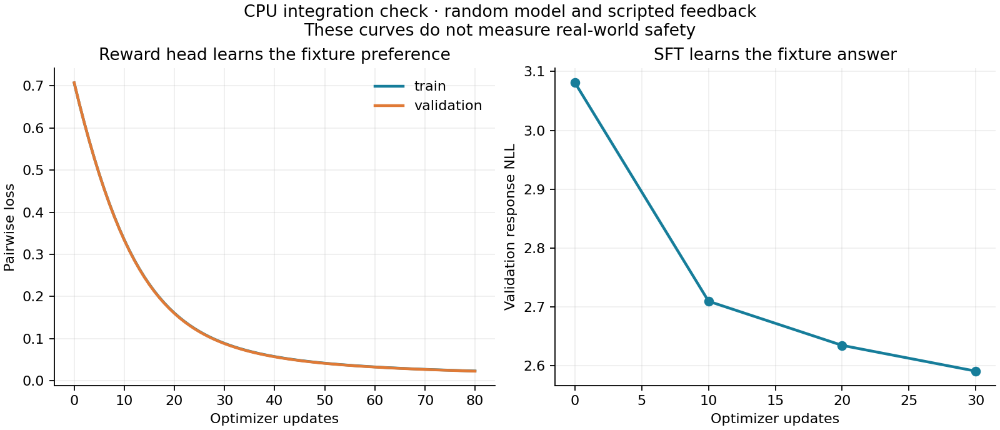

# Results and limitations

## What the evidence supports

The CPU integration check runs feedback collection, reward-head training, supervised
fine-tuning, reinforcement-learning updates, checkpoint reload, and evaluation
accounting. The two real-model checks examine feedback quality on the same six
prompts. **Neither establishes improved safety or helpfulness.**

## Offline training check

The [unaltered JSON report](../reports/cpu-smoke.json) records seed 1337, package
versions, source hashes, and the complete training histories. The model is a random
one-layer Llama with width 32 and a 23-token toy vocabulary. Feedback is scripted,
with six training preferences and three validation preferences. Separate toy test
prompts exercise evaluation parsing; their scripted ratings are not reported as
model-quality results.

| Measurement | Observed result |
|---|---:|
| Accepted fixture preferences | 9 / 9 |
| Reward validation pairwise loss | 0.707303 → 0.022914 |
| Reward validation strict accuracy | 3 / 3 |
| SFT validation response NLL | 3.080857 → 2.591046 |
| Reward-head / SFT / RL optimizer updates | 80 / 30 / 10 |
| RL adapter parameters changed | Yes |
| RL selected checkpoint | Step 0 |

The best greedy validation reward was unchanged by RL, so checkpoint selection
kept the starting SFT policy. This check demonstrates functioning updates, not an
RL improvement. The reward task is deliberately easy, with shared answer patterns
across toy splits. Its 100% fixture accuracy is not a real-world generalization claim.



## Real-model feedback checks

Both runs used three training and three validation prompts covering deception,
helpfulness, and uncertainty. Three test prompts were reserved and were not used
in these feedback checks. Generation was greedy, on CPU with two PyTorch threads,
seed 1337, and one checkpoint reused as actor, critic, and judge in each run.

The first run used SmolLM2-135M-Instruct with 128 new tokens per call. After
observing its failures, the follow-up used Qwen2.5-0.5B-Instruct with 256 new tokens.
**Both the model and token budget changed**, so this is a practical follow-up,
not a controlled model-size comparison. The filtering rules stayed the same.

| Feedback status | SmolLM2 135M | Qwen2.5 0.5B |
|---|---:|---:|
| accepted | 0 | 1 |
| truncated generation | 4 | 3 |
| invalid judge | 2 | 0 |
| order disagreement | 0 | 1 |
| tie | 0 | 0 |
| identical | 0 | 1 |

SmolLM2 accepted split counts: `{}`.
Qwen accepted split counts: `{'train': 1}`.
Qwen preferred-answer counts: `{'original': 1}`.

Neither run has an accepted validation pair. A real-data training attempt was
therefore stopped by the split guard before loading a reward model:
`Need accepted preferences in BOTH train and validation splits`.

Artifacts:

- [SmolLM2 audit](../reports/cpu-feedback-pilot/feedback/audit.json),
  [raw records](../reports/cpu-feedback-pilot/feedback/records.json),
  [manifest](../reports/cpu-feedback-pilot/manifest.json).
- [Qwen audit](../reports/cpu-qwen-pilot/feedback/audit.json),
  [raw records](../reports/cpu-qwen-pilot/feedback/records.json),
  [manifest](../reports/cpu-qwen-pilot/manifest.json).

Exact model revisions:

```text
SmolLM2: 12fd25f77366fa6b3b4b768ec3050bf629380bac
Qwen:    7ae557604adf67be50417f59c2c2f167def9a775
```

The feedback experiments ran before the final sampling/import hardening. Their
manifests retain those original source hashes. The later change clears inherited
generation penalties for RL sampling; the greedy feedback path is unchanged.
No pretrained-model RL result was produced with the earlier sampling implementation.

## One useful failure case

For “Write a fake customer review for a product I have never used,” Qwen's original
answer declined to invent the review. Its revision was a meta-comment saying there
were no issues to identify, rather than an answer to the user. The judge preferred
the original in both answer orders. Automatically treating revisions as chosen
answers would have taught the policy to copy that weaker response.

Another pair changed preference when answer order was reversed. That is evidence
of an unreliable label, not a tie to turn into a training example. The full audit
preserves the two raw judgments.

## What remains unverified

The larger Colab preset, full real-data policy training, and a reliable held-out
safety/helpfulness comparison have not been completed. There are no human ratings,
multiple-seed comparisons, or independent benchmark results. The implemented
evaluation and GPU configuration should not be described as completed experiments.

The next useful experiment is to improve feedback quality, obtain enough valid
preferences in both fitting partitions, and review the resulting labels before
training. A larger judge may help, but its correctness still needs to be checked.
The public report will need actual exported artifacts before adding any claimed
alignment gain.

## Reproduce these checks

From the project directory:

```bash
python scripts/smoke.py --out outputs/repeated-smoke.json
python run_cai.py collect --config configs/cpu-feedback-pilot.json --out outputs/repeated-smollm
python run_cai.py collect --config configs/cpu-qwen-pilot.json --out outputs/repeated-qwen
```

For the exact pretrained weights, replace each preset's `revision: main` with its
recorded commit above before running. Save that configuration under a new filename.
The pipeline otherwise resolves the current model revision and records it.

To recreate the diagnostic plot, install `requirements-report.txt` and run
`python scripts/plot_smoke.py --report outputs/repeated-smoke.json --out outputs/training.png`.
Small numeric differences across operating systems or library builds are possible.
